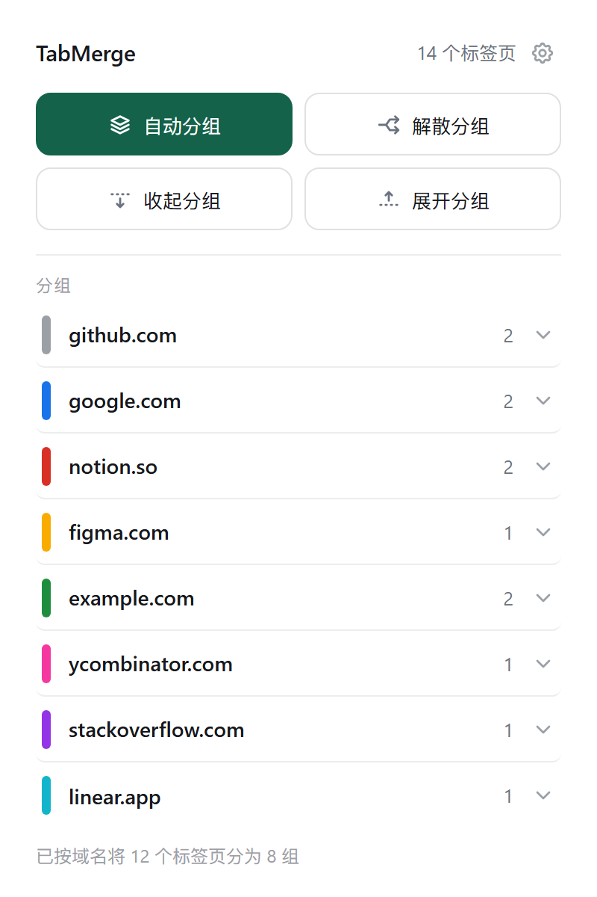
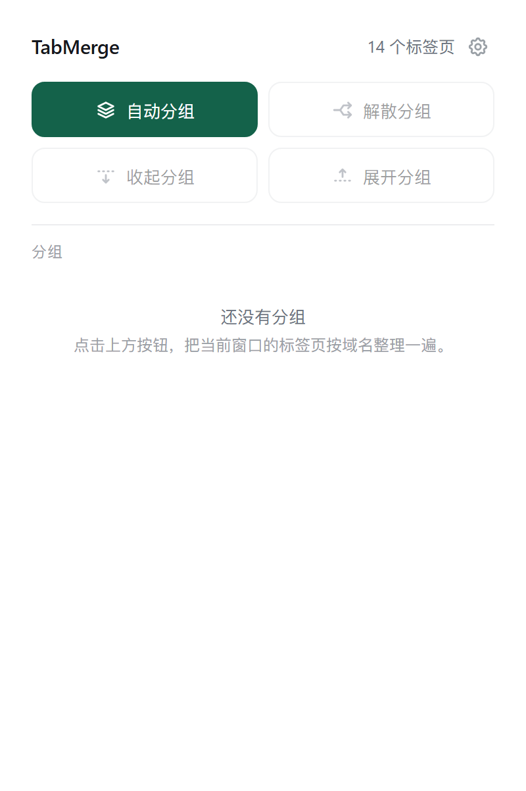
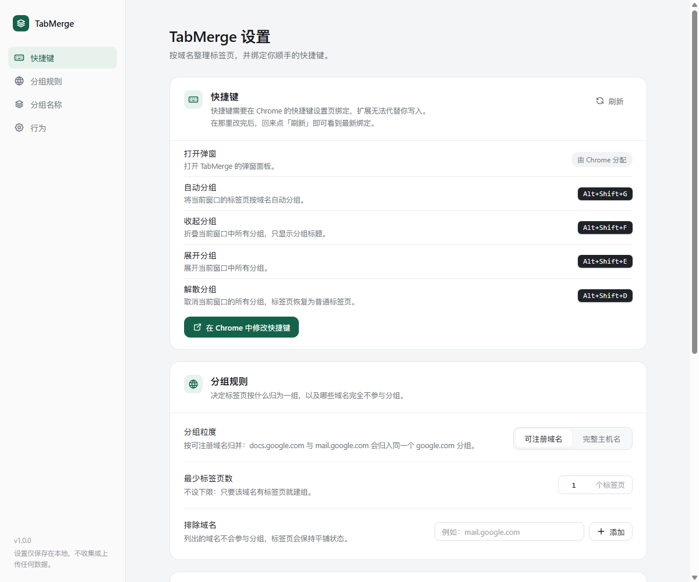
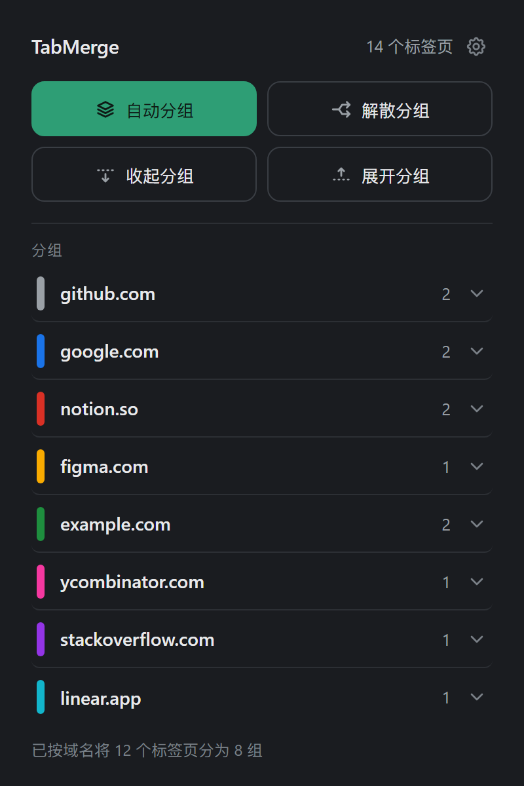

# TabMerge

Chrome 扩展：一键把当前窗口的标签页按域名分组，配全收 / 全展 / 全散三个批量操作，快捷键可自定义。

零构建 —— 纯静态文件，「加载已解压的扩展程序」即可用。



## 安装

1. 打开 `chrome://extensions/`
2. 右上角打开「开发者模式」
3. 点「加载已解压的扩展程序」，选择本仓库的 **`extension/`** 目录
4. 工具栏出现绿色层叠图标即为装好（可右键固定到工具栏）

> Chrome 137 起命令行 `--load-extension` 已失效。仓库内的 `tools/verify-extension.mjs` 改用 CDP 的 `Extensions.loadUnpacked` 装载，不需要你手动操作。

## 功能

**弹窗**（点工具栏图标）



- 四个操作按钮排成 2×2：**自动分组**、**收起分组**、**展开分组**、**解散分组**
  - 「自动分组」：把当前窗口的标签页按可注册域名归组，每组自动使用 Chrome 原生标签组配色；设置里可设「最少标签页数」，只有同域名标签页达到该数量才建组
  - 「收起分组」「展开分组」：批量折叠 / 展开当前窗口内的所有分组
  - 「解散分组」：解除当前窗口内所有分组的分组关系，**不会关闭任何标签页**
- 鼠标悬浮在按钮上会显示该操作当前的快捷键（未绑定时显示「未绑定快捷键」）
- 点清单中的任意一行：单独折叠 / 展开该组
- 右上角齿轮按钮：打开设置页

「新标签页并入同域分组」与「无对应分组时自动新建」是两个独立开关：只开前者，新标签页只会并入已有分组，找不到就什么都不做；只开后者，只有在没有对应分组时才会新建。

**最少标签页数**（默认 1 = 不限制）解决「满屏单标签分组」的问题：

- 设成 2 时，只有同域名标签页有 2 个及以上才建组，不足的域名保持散放
- 「自动分组」的结果提示会告诉你有几个域名因阈值没分组
- 自动新建分组时同理：第一个同域标签页先散放，攒够数量再一起归入新组；「并入已有分组」不受阈值影响

**自定义分组名**

- 在 Chrome 里右键分组 → 重命名，改成「工作」「设计稿」这类你习惯的名字
- TabMerge 会记住这个改名，下次按域名分组时，同一域名自动沿用它
- 把名字改回域名本身即视为取消自定义
- 弹窗里会同时显示自定义名和原域名（「工作 · github.com」），设置页的「分组名称」区块里可以逐条删除

**设置页**（弹窗右上角齿轮直达）



左侧固定导航栏，右侧按分区卡片展示：

- **快捷键**：五个操作各自的说明、当前绑定（黑色键帽样式）与状态，一键直达 Chrome 的快捷键设置页
- **分组规则**：分组粒度（可注册域名 / 完整主机名）、最少标签页数、排除域名
- **分组名称**：查看并删除已记住的自定义分组名
- **行为**：跳过固定标签页（默认开）、新标签页并入同域分组（默认关）、无对应分组时自动新建（默认关）

侧栏随滚动联动高亮当前分区；窗口窄于 880px 时侧栏自动收成图标条。暗色模式跟随系统自动切换：



## 快捷键

Chrome 不允许扩展用代码写入快捷键，键位需要在 `chrome://extensions/shortcuts` 里绑定；设置页会显示当前绑定状态并提供跳转入口。

扩展提供的默认建议键位：

| 操作 | 默认键位 |
|---|---|
| 自动分组 | `Alt+Shift+G` |
| 收起分组 | `Alt+Shift+F` |
| 展开分组 | `Alt+Shift+E` |
| 解散分组 | `Alt+Shift+D` |
| 打开弹窗 | 由 Chrome 分配，可在快捷键页改 |

> 若某个默认键位被 Chrome 或其它扩展占用，Chrome 会跳过它，在设置页显示为「未设置」，自行绑定即可。

## 权限

只申请三项，不含任何网站访问权限：

- `tabs` —— 读取标签页 URL 以提取域名
- `tabGroups` —— 创建、折叠、解散标签组
- `storage` —— 保存设置

设置只存在浏览器本地，不收集也不上传任何数据。

## 目录结构

```
extension/            ← 「加载已解压的扩展程序」选这个目录
  manifest.json
  background.js       service worker：快捷键命令 + 自动归组监听
  core/
    domain.js         可注册域名解析与标签页过滤（零依赖，可单测）
    naming.js         自定义分组名的学习与应用（纯函数，可单测）
    groups.js         分组 / 折叠 / 解散执行器
    settings.js       设置读写与归一化
    icons.js          Tabler 图标内联模块（由脚本生成）
  popup/              弹窗（HTML / CSS / JS）
  options/            设置页（HTML / CSS / JS）
  ui/tokens.css       设计令牌（亮色 / 暗色）
  icons/              工具栏图标 PNG（16/32/48/128）
  lib/tabler/         Tabler Icons 官方 SVG + 其 MIT 许可
tools/
  make-icons.mjs      重新生成 core/icons.js 与图标 PNG
  verify-extension.mjs  真实 Chrome 实机验证（65 项）+ 截图
test/                 node --test 单元测试与静态检查
docs/
  images/             实机截图（README 配图）
  design/             选定的视觉基准 + 设计 QA 报告
```

## 开发

```powershell
# 单元测试与静态检查
node --test

# 重新生成图标（需本机安装 Chrome）
node tools/make-icons.mjs

# 真实 Chrome 实机验证 + 截图（需本机安装 Chrome）
node tools/verify-extension.mjs
```

实机验证会启动一个独立的临时 Chrome profile，通过 CDP 装载扩展，用本地代理造出真实形态的标签页 URL（`github.com`、`docs.google.com` 等），跑通分组、逐组折叠、全收全展、全散、重新分组、粒度切换、排除域名、固定标签页跳过、最少标签页数阈值、自动归组等路径，并把截图输出到 `docs/images/`。不会碰你的浏览器数据。

## 设计

「静谧清单」方向：纯白底、深墨绿主按钮、左侧 6px 细色条清单行，Chrome 原生 8 色标签组是界面里唯一的彩色来源。深色模式跟随系统自动切换。详见 [`docs/design/design-qa.md`](docs/design/design-qa.md)。

## 许可证

MIT，见 [LICENSE](LICENSE)。图标来自 [Tabler Icons](https://tabler.io/icons)（MIT），原始 SVG 与其许可保留在 `extension/lib/tabler/`。
